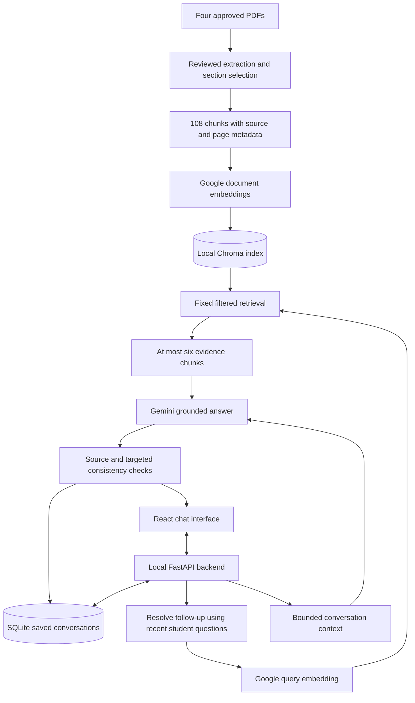

# CFD Student Compass
## Project brief for an independent question reviewer

**Project status described here:** 16 October 2026, Pakistan time.  
**Purpose of this brief:** Understand the application before reading the four supplied PDFs and preparing your own test questions. This document deliberately contains neither the existing question bank nor its answer key.

## 1. What we are building

**CFD Student Compass** is a student-built conversational helpdesk for **FAST-NUCES undergraduate students, with campus-specific coverage for Chiniot-Faisalabad (CFD)**.

It helps students understand documented academic rules, student procedures, campus services, hostel information, societies, scholarships and study loans. It should explain the applicable rule, preserve its conditions and exceptions, and show the document passages supporting its answer.

This is a **local application**, opened at `http://localhost:8501` on the owner's laptop. The current frontend uses **React**, replacing the original Streamlit interface. Deployment is outside the present scope. It is an independent student project, not an official university service or an authority that can approve a student's request.

The central requirement is **grounded usefulness**: a fluent answer is not sufficient if it gives the wrong condition, overlooks an exception, uses another campus's information, or cites a passage that does not support its claim.

## 2. The four knowledge sources

The application uses selected, reviewed material from these files:

| File | What it contributes |
|---|---|
| `Academic_Rules_Handbook_2026.pdf` | Undergraduate academic rules and regulations, including the canonical Generative AI policy used by the project |
| `Student_Handbook_2026.pdf` | Student conduct, financial rules and assistance, examinations, library services, computing labs and other student procedures |
| `Student-Guide-Book-2026.pdf` | CFD campus introduction, societies and mentors, student FAQs, facilities, hostels and office contacts |
| `FAST_Financial_Assistance_Scholarships.pdf` | A reformatted financial-assistance/scholarship webpage snapshot, collected on **8 October 2026** |

The scholarship snapshot's collection date is **not a policy effective date**. The documents are snapshots: the system cannot establish that a printed contact, charge, policy or application deadline is still current today.

### Important: having four PDFs does not mean indexing every page

The current knowledge base contains **31 approved sections, prepared as 108 text chunks**, under dataset version `2026-reviewed-v1`. Chunking targets approximately 600 tokens with 80-token overlap. The originals are preserved. Selected tables and scanned text needed reviewed extraction/OCR corrections.

Use the scope below when choosing questions. Page numbers here are **one-based PDF page positions**, which may differ from the printed page numbers visible on the document.

### Academic rules: included scope

- **PDF 7–10:** instruction, academic year, credit hours, class scheduling, attendance and degree requirements.
- **PDF 11–13:** grades and GPA calculations.
- **PDF 15–18:** readmission, campus transfer and closure of admission.
- **PDF 19–23:** registration, academic-warning restrictions, theory/lab combinations, FYP, suspended registration, semester freezing, adding/dropping, withdrawal and replacement.
- **PDF 24–27:** assessment, warnings, repetition, missed examinations and rechecking.
- **PDF 28–29:** summer-semester rules.
- **PDF 30–32:** graduation awards and honors.
- **PDF 33–36:** academic honesty and disciplinary penalties.
- **PDF 37–39:** retake examinations.
- **PDF 40–55:** Generative AI policy, including assessment use, referencing, privacy, support and review.

### Student handbook: included scope

- **PDF 8–16:** code of conduct.
- **PDF 18–22:** financial rules and undergraduate financial assistance.
- **PDF 23–24:** disciplinary conduct; **PDF 25:** migration.
- **PDF 26–28:** examination rules; **PDF 29–30:** semester rules.
- **PDF 31–36:** library services and undergraduate borrowing rules.
- **PDF 37–38:** computer-lab rules.
- **PDF 39–40:** CFD student-society entries, rather than other campuses' society lists.
- **PDF 45:** the handbook's campus-hostel facility statement.
- **PDF 46–47:** retake-examination policy.

### CFD guidebook: included scope

- **PDF 4:** campus introduction.
- **PDF 7–11:** society introductions; **PDF 12:** society mentors.
- **PDF 13–14:** student FAQs, such as academic support, portals and relevant help routes.
- **PDF 16–20:** campus facilities.
- **PDF 22:** hostel facilities; **PDF 23–24:** hostel FAQs and related rules/charges.
- **PDF 29–36:** important campus contacts and office responsibilities.

### Scholarship snapshot: included scope

- **PDF 1–2:** undergraduate financial assistance, internal sponsorships, merit scholarships, study loans and relevant named assistance schemes.
- Graduate-only rows or schemes are excluded, even if they share a page with undergraduate information.

### Intentionally excluded material

- Academic PDF 14: new-admission/external-applicant credit-transfer rules.
- Postgraduate-only requirements, limits and scholarship material.
- Other campuses' society lists and campus-specific room/facility/contact details.
- The duplicate handbook AI section: the academic-rules AI policy is the canonical indexed version.
- Guidebook promotional material, alumni/placement profiles and external tourism, restaurant, shopping or hospital listings.
- Any additional prospectus, website or document beyond the four agreed sources.

You may deliberately ask about excluded material to check that the system admits its coverage limit. Label those as **scope-boundary tests**, rather than assuming every fact anywhere in the original PDFs must be answerable.

## 3. How an answer is produced

The application uses **ordinary conversational Retrieval-Augmented Generation (RAG)**. The model is not trained or fine-tuned on the PDFs.

1. A submitted question is saved locally before generation starts.
2. For a follow-up, the chat model rewrites it into a standalone retrieval question using recent **student questions**. This keeps unasked details in previous assistant answers out of the rewrite input and reduces topic drift.
3. A hosted embedding model turns the retrieval question into a numeric vector.
4. Chroma searches the persisted document index, applying undergraduate and university-wide/CFD scope filters.
5. The fixed retrieval step normally uses similarity search. For selected cross-page or multi-part topics, predetermined additional searches help retain linked conditions. The final evidence set contains at most **six chunks**, within an approximately **4,000-token evidence budget**.
6. The chat model receives the current question, bounded conversation context and selected evidence. It is instructed to answer from that evidence and cite the supplied source IDs.
7. The application validates source identifiers and performs targeted source-consistency checks before saving and displaying the completed answer and references. A validation failure is shown as a recoverable failure, not treated as a correct policy answer.

There are **no agents, web-search tools, corrective retrieval loops, answer-grading models, CRAG or Self-RAG stages**. These checks are not a general mathematical proof that every generated sentence is correct; independent testing remains necessary.

## 4. Technical stack and where data lives

| Component | Current implementation |
|---|---|
| Frontend | React, TypeScript and Vite |
| Local backend | Python with a thin FastAPI adapter |
| RAG composition | LangChain / LCEL |
| Chat model | Gemini Developer API: `gemini-3.5-flash-lite` |
| Embeddings | Gemini Developer API: `gemini-embedding-2`, 768 dimensions |
| Document search | Chroma, persisted on the laptop |
| Conversations | SQLite, persisted on the laptop |
| Document preparation | PDF text extraction plus reviewed OCR/table corrections where needed |

The laptop runs the interface, retrieval and local storage. **No chat-model or embedding-model weights are downloaded or run locally.** Document vectors are reused when the dataset and indexing configuration are unchanged.

The project is intended to use free-tier APIs, without purchases or a paid fallback. New policy answers require internet access and available provider quota. A provider quota failure is an **availability failure**, not evidence that the underlying policy answer is correct or incorrect.

Relevant question text, bounded history and document evidence are sent to Google for API inference. API keys stay in local backend configuration and must not be included in test questions or shared files. This is one local workspace without accounts, authentication or a multi-user privacy boundary.

## 5. Chat interface, saved history and memory

Implemented behavior includes:

- A new empty draft whenever the application is opened or refreshed. This does not automatically reopen the previous chat or create an empty saved conversation.
- A sidebar for new chats, searching saved chats and manually reopening a conversation.
- Hover menus to rename or delete a saved chat.
- Immediate display of a submitted user message, timestamps and a loading state while the backend works.
- Expandable sources with document titles, excerpts, PDF page positions and printed page labels, plus inline citation links.
- Durable questions, completed answers, citations and timestamps across restarts.
- Saved failed/interrupted questions with recovery options. Retrying should not create duplicate user turns.
- Local requests to list prior questions or recap the current saved chat, without requiring policy citations or an API call.

**Stored history and active model memory are different.** The full transcript remains saved and readable. Answer generation receives only the latest **six completed exchanges**, capped at an estimated **2,500 tokens**. Retrieval rewriting receives bounded recent student questions rather than previous assistant checklists. Older details may fall outside active model context, and ambiguous references may need clarification. Local transcript lookup can still list older saved questions.

Previous assistant answers are context, **not policy evidence**. Each new policy question retrieves document evidence again. A new conversation must not inherit the previous conversation's topic or transcript. An unsent text draft is not a persisted message.

## 6. What good behavior looks like

For an answerable question, the system should:

- Address every requested part, with the correct campus, degree and semester scope.
- Preserve thresholds, units, dates, deadlines, approving authorities, conditions and exceptions.
- Distinguish a discretionary allowance from guaranteed eligibility or official approval.
- Calculate from documented quantities when needed, without inventing a personal balance or bill.
- Cite evidence that supports the nearby claim, with correct document/page metadata.
- Preserve printed contact details rather than silently changing unusual spellings or domains.

For other requests, it should:

- Ask for clarification when the intended course, policy or reference is unclear.
- Acknowledge insufficient evidence instead of inventing facts.
- Separate answerable document-based parts from unsupported parts of a mixed question.
- Explain genuine disagreements between sources and cite both, instead of silently choosing a convenient rule.
- Resist instructions to ignore the documents, invent a source or accept an unsupported user assertion as official policy.

It cannot access personal FLEX records, check a live room vacancy or bus departure, establish a current application opening/date, predict admission merit, issue official approval, or browse the web for a newer rule.

## 7. How your independent questions can help

Please read the supplied PDFs and prepare questions **independently of the existing development question bank**. The useful contribution is new wording, new combinations and cases the developer has not already tuned against.

Include a mixture of:

| Test type | What to probe |
|---|---|
| Straightforward | A directly stated rule, service, office, contact or table entry |
| Intermediate | A rule with its required condition, exception or procedural step |
| Complex | Multiple requested facts, cross-section/cross-document reasoning or calculations |
| Confusing | A false premise, similar terms, boundary values, reversed conditions or a misleading assumption |
| Conversational | Follow-ups, pronouns, corrections, topic changes, new-chat isolation and resuming a saved chat |
| Unsupported/mixed | Excluded scope, live/personal information, official decisions or a supported question combined with an unsupported request |
| Adversarial | Pressure to ignore evidence, fabricate a citation, hide a source conflict or guarantee an outcome |

Distribute questions across **all four sources and the included topics**, rather than concentrating only on academic withdrawal or scholarships. For long conversations, specify the order and whether each turn belongs to the same chat or a new chat.

Prepare a private reviewer record for each question:

```text
Question ID:
Question to send to the chatbot:
Difficulty / test type:
Standalone or conversation sequence:
Required earlier turns, if any:
Expected behavior: answer / clarify / abstain / qualified partial answer
Supporting PDF filename(s):
PDF page position(s), and printed labels if useful:
Facts and material conditions the answer must preserve:
What would count as a wrong or incomplete answer:
```

**Keep the expected answer separate from the chatbot input.** Send only the question and any intended conversational context to the system. Otherwise, the test may measure whether it repeats the supplied answer rather than whether retrieval and grounding work.

If a rule is unclear or conflicting in the PDFs, record that uncertainty. Do not turn an interpretation into a supposedly definitive answer key. Exact wording need not match your key; meaning, conditions and source support should.

## 8. How we will judge the results

We will assess these separately:

1. **Retrieval:** Did the selected passages contain all the necessary supporting facts?
2. **Evidence coverage:** Did those passages actually reach the answer prompt, rather than being retrieved and discarded?
3. **Answer quality:** Is the response correct, complete, relevant and appropriately qualified?
4. **Citations:** Do the references resolve to the right excerpts/pages, and do those excerpts support the claims?
5. **Conversation behavior:** Did follow-ups retain the intended topic and did separate chats remain isolated?
6. **Application reliability:** Were messages saved, failures recoverable and retries free of duplication?

A relevant-looking citation is not enough. Likewise, a guessed correct answer is not a retrieval pass when the required evidence was absent. Unexecuted or API-blocked cases must not be marked passed.

## 9. What has been completed and what is still pending

The earlier bd8f22bf0e66e76c qualification is historical. Two later user conversations exposed new defects, so it cannot certify the repaired application. Current revision57c6ad6dc291e079 is blocked by daily APIquota during fresh qualification. Current results and pending cases are recorded in reports/publication/final-status.json and evaluation/publication/pending-tests.json.

The updated revision passed272Python tests,25Chromium checks, sixprocess/setup/indexreuse checks and84/244additionalquestions. The remaining160additionalcases, suppliedreplays, original187questions, original10sequences, sixnewsequences and freshproviderbrowser remain pending atthisrevision; do notcountpendingcasesaspasses. Test databases are isolated; production conversations, PDFs and the index remain unchanged at the recorded integrity check.

Independent university-policy review and the joint fresh human-authored live test remain publication gates. No finite test bank guarantees future accuracy, and provider availability remains quota-dependent.

## 10. Architecture at a glance



The diagram describes a fixed conversational RAG pipeline. It does not imply training, autonomous agents, web browsing or deployment.
