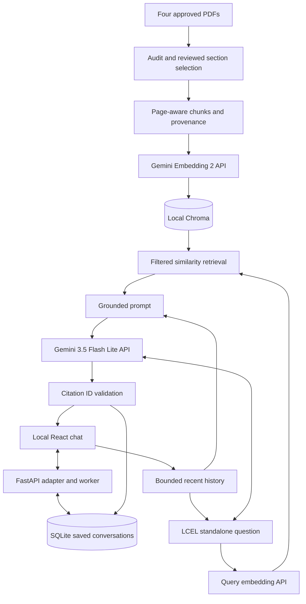

# CFD Student Compass

**A source-grounded, conversational guide to FAST-NUCES undergraduate policies and the Chiniot–Faisalabad campus.**

**Verification update — 20 October 2026:** the latest focused checks passed: 15 ordered live HTTP turns, 5 live React turns, 59 targeted Python checks, 25 Chromium workflow checks and 6 process/recovery checks. Actual answer/source comparison is distinct from automated workflow checks. The complete historical bank was not rerun on the latest revision, and independent high-impact university-policy review remains pending. See [verification scope](docs/VERIFICATION.md). Publishing this code is not an official university endorsement or a guarantee of future accuracy.

A local, student-built FAST-NUCES CFD undergraduate helpdesk. **React + TypeScript frontend, FastAPI local adapter**, Python, LCEL, Gemini API, Chroma and SQLite. No deployment, accounts, agents, CRAG, Self-RAG, or local model weights.

## Current state

The application, reviewed ingestion pipeline, durable chat history, API preflight, evaluation tools and offline automated tests are implemented. The local development dataset was audited and prepared as **108 chunks**. Reviewed sections and corrected OCR are configured in `sources.json`. The guidebook needed OCR; the handbooks required visible-page coordinate filtering to remove hidden adjacent-page text.

**A fresh clone does not include PDFs, API keys, an index or saved chats.** Supply your approved original files and build the local index before asking document questions. `sources.json` records exact filenames, titles, hashes, section ranges and applicability. Raw `reports/` references below describe local generated artifacts; those files are intentionally excluded from Git to avoid publishing private transcripts or databases.

Live Gemini access and creation of the 108-chunk index were verified in development. Historical larger banks and targeted repairs remain distinct from the latest focused run; their earlier results do not certify every later revision. The React migration preserves the RAG and SQLite interfaces; its design history is in `REACT-MIGRATION-PLAN.md`.

## Features

- Responsive React chat with locally bundled fonts, an ink-blue sidebar, ivory canvas, compass artwork, prompt cards and reduced-motion support.
- New empty draft on page opening; saved chats reopen manually without losing messages.
- Search, rename and delete saved chats; initial titles come from the first question without an extra model call.
- Immediate user messages, generation indicators, timestamps, copy controls and recoverable failures.
- Expandable document sources and optional technical/retrieval details.
- Contextual follow-ups, corrections, topic changes, saved-question recall and extractive recap.
- Persistent pending/failed turns, idempotent submission, explicit retry and discard.
- Cached document embeddings and persistent index reuse.

These are implemented features with targeted verification, not a promise that every future wording will succeed. The UI polls completed answers; token-by-token answer streaming is not implemented.

## Technology

| Component | Implementation |
|---|---|
| Frontend | React, TypeScript, Vite, Lucide, bundled DM Sans and Manrope |
| Answer rendering | React Markdown, GFM and KaTeX |
| Backend | FastAPI, Uvicorn, one loopback-bound process |
| RAG composition | LangChain Core and LCEL |
| Chat model | `gemini-3.5-flash-lite` via Gemini Developer API |
| Embeddings | `gemini-embedding-2`, 768 dimensions, API only |
| Evidence store | Persistent local Chroma |
| Conversations | Local SQLite through Python `sqlite3` |
| Documents | pypdf, reviewed text/table/scope overrides and reviewed Windows OCR |
| Verification | pytest, Chromium/Playwright, process checks and explicit live-provider tools |

## Knowledge base

1. **Undergraduate Academic Rules and Regulations 2026:** academic progression, grading/GPA, warnings, registration, theory/lab, FYP and examination procedures.
2. **Student Handbook 2026:** conduct, disciplinary wording, library services and financial assistance rules.
3. **CFD Student Guide Book 2026:** approved campus services, hostel information, printed charges and contacts.
4. **Financial Assistance / Scholarships (webpage snapshot):** approved undergraduate portions of the supplied scholarship snapshot (`FAST_Financial_Assistance_Scholarships.pdf`).

The authoritative fourth-document title and all exact original filenames are recorded in `sources.json`. Use these documents only where you have permission. Third-party policy documents and their contents remain the material of their respective owners; the repository does not assert ownership of them.

## Clone the repository

```powershell
git clone https://github.com/AhmadAbdullah75/Fast_Student_Compass.git
cd Fast_Student_Compass
```

Continue with the clean-install instructions below before using the launcher.

## Quick start (PowerShell)

Open a terminal in this project folder. Python 3.12 x64 and Node.js 22.12+ were used for development. A clone needs the clean-install steps below: virtual environments, frontend dependencies and built assets are not committed.

```powershell
.\run.ps1
```

Open **http://localhost:8501**. The script builds the React frontend, then starts one Python server serving both the UI and API. It binds to loopback only. Stop it with Ctrl+C. Close the old Streamlit server first if it is still occupying port 8501. To use an already-built frontend, run `.\run.ps1 -SkipBuild`.

From Git Bash, use:

```bash
powershell.exe -NoProfile -ExecutionPolicy Bypass -File ./run.ps1
```

For a clean installation or a moved project, recreate `.venv` rather than copying it:

```powershell
python -m venv .venv
.\.venv\Scripts\python -m pip install --upgrade pip
.\.venv\Scripts\python -m pip install -r requirements-lock.txt --no-cache-dir
# Only for a new setup without an existing key:
if (-not (Test-Path .env)) { Copy-Item .env.example .env }
cd frontend
npm.cmd ci
npm.cmd run build
cd ..
.\.venv\Scripts\python -m uvicorn compass.web:app --host 127.0.0.1 --port 8501
```

Node is needed for building/developing the frontend, not for running the built app. No API key is included in React or sent to the browser. The existing `.env`, originals, Chroma index, and SQLite conversations remain in place. The old `app.py` is retained as an optional legacy interface; it is not used by the default launcher.

Saved chats work without an API key. New policy questions remain disabled until a key and index exist. Every page opening starts an empty **draft**. A SQLite conversation is created only when sending its first message, so refreshing does not fill the sidebar with empty chats. Previous conversations are opened manually from the sidebar.

For the exact approved original files, reviewed extraction overrides are already configured. Supply those files locally, add the key to `.env`, verify billing/quota in AI Studio, inspect audit/preparation, then run `preflight` and `ingest` below. Different source files require a fresh review rather than blindly replacing their hashes.

`requirements.txt` declares compatible ranges; `requirements-lock.txt` records the exact versions tested on Windows/Python 3.12. Chroma has transitive ONNX/tokenizer libraries, but this app never initializes its default embedding model. It explicitly uses Gemini embeddings, with no model-weight downloads. No Docker, Torch, Ollama or database server is needed.

## 1. Add and inspect the dataset

Place the unchanged PDFs in `data/originals/` with the filenames in `sources.json`, or change the filenames there to match your files. There must be four approved sources. Source URLs left blank are deliberately unknown; do not guess them.

```powershell
New-Item -ItemType Directory -Force data/originals
.\.venv\Scripts\python -m compass.cli audit
.\.venv\Scripts\python -m compass.cli prepare
```

Audit is local and makes no API calls. It creates per-page extraction reports in `reports/`, including SHA-256 hashes, extracted text, PDF page numbers and PDF labels. Short/empty pages are flagged for review. Open original PDFs visually to check tables, columns, omissions and visible printed page labels. PDF labels may be default numbers rather than actual printed numbering. For the current guidebook, reviewed OCR overrides are already configured; the raw audit still correctly reports its empty native text layer. New image-only pages without reviewed overrides block ingestion.

For every source in `sources.json`, copy the inspected hash into `reviewed_sha256` and configure reviewed sections. **All PDF ranges use inclusive, one-based PDF page numbers.** Example structure only (replace the example ranges and title with verified values):

```json
{
  "title": "Exact section heading from the PDF",
  "pdf_start": 5,
  "pdf_end": 7,
  "campus": "all",
  "degree": "undergraduate",
  "printed_labels": {"5": "1", "6": "2", "7": "3"},
  "text_overrides": {}
}
```

Use `campus: "CFD"` only for CFD-specific material; `all` denotes university-wide information. Degree is `undergraduate` or `all`. Exclude postgraduate-only material. If a page mixes included and excluded material, use a manually verified `text_overrides` entry keyed by PDF page number to retain only the approved text, or exclude that page. Use overrides to repair table extraction while preserving its meaning. Keep exceptions alongside their rule. Sections may be subdivided where headings change.

Optional source-level `remove_lines` is a list of exact header/footer lines reviewed for removal. Nothing is automatically removed by guessing. Identical passages with identical campus/degree scope are deduplicated while preserving all reference locations. Near-duplicates remain for manual review.

Keep academic rules, relevant handbook services, relevant CFD guidebook sections, and undergraduate financial assistance. Exclude guidebook promotions, tourism, restaurants, alumni profiles, placement lists, and postgraduate scholarships. Do not add the 2025 prospectus. Verify the scholarship snapshot collection date against the supplied PDF; it is not a policy effective date.

For future image-only guidebook updates, `tools/windows-ocr.ps1` uses Windows PowerShell 5.1 and the installed English Windows OCR engine. Render pages as `guide-01.png`, `guide-02.png`, etc. with Poppler first, then invoke the script with `-ImageFolder` and `-OutputFile` absolute paths through `powershell.exe -NoProfile -File`. Inspect OCR against page images before adding overrides. Normal startup and ingestion use the saved reviewed overrides and never rerun OCR.

## 2. Verify free API access

Create a Gemini Developer API key in Google AI Studio, and paste it into `.env` locally as `GOOGLE_API_KEY`. Do not paste keys into chats or commit `.env`. Keep the Google project on the free tier with **paid billing disabled**. The application cannot inspect or enforce your Google account's billing status; using a billed project can incur charges at the provider even though the application never upgrades or falls back.

Restart the app after changing `.env` so the process picks up new settings.

```powershell
.\.venv\Scripts\python -m compass.cli preflight
```

This makes one chat call and separate document and query embedding calls, checks dimensions, and confirms model access. Confirm quotas and billing status in AI Studio before ingestion. Public availability does not guarantee an individual account's quota. Configured defaults are `gemini-3.5-flash-lite` and `gemini-embedding-2`, 768 dimensions. Availability can change. Failed model access stops; it never switches providers or uses paid fallbacks.

Google may use free-tier input for product improvement. Relevant recent messages, query text and selected document passages leave the laptop. Do not submit personal records. Chat files on this single-workspace prototype are local and are not encrypted or access-controlled.

## 3. Build the index, then chat

```powershell
.\.venv\Scripts\python -m compass.cli ingest
.\run.ps1
```

Ingestion refuses unreviewed hashes or empty section selections. Chunks target 600 estimated tokens with 80 overlap, respecting paragraph/line boundaries where possible. Sections are joined across page breaks; character spans map each resulting chunk back to the pages it actually overlaps. Counts use UTF-8 bytes/3 as a conservative local estimate, not the exact proprietary Gemini tokenizer. Oversized tables need manual review/overrides; automatic extraction cannot guarantee semantic boundaries.

Each chunk is independently embedded with Google's retrieval document prefix. Query embeddings use the question-answering prefix. The implementation uses Google's supported SDK behind LangChain's `Embeddings` interface to explicitly avoid Embedding 2's multi-input aggregation. LCEL composes rewriting, retrieval and answering.

Embeddings are cached on disk per model/dimension/text. Ingestion upserts missing chunk IDs and can resume after quota failure without re-embedding completed chunks. Only successful full ingestion publishes the active manifest. Unchanged ingestion reuses the index without API calls. Changing original PDFs, source selection or embedding/chunk configuration requires re-ingestion. New collections retain old versions for reproducibility; embedding cache and old collections consume disk as the dataset evolves.

Data paths:

- `data/chats.sqlite3`: conversations, complete/failed/pending turns, citations and provenance.
- `data/chroma/`: local vector index; `data/manifest.json`: active dataset/config fingerprint.
- `data/embedding-cache.sqlite3`: reusable document vectors.
- `reports/`: local audit, evaluation and verification results.

Back up the entire `data/` folder while the app is stopped. Originals remain unchanged. Never delete `data/` to reset the index if you want to preserve chats.

## Conversational behavior

New chats have isolated histories. First question supplies the title without a model call. Rename/delete controls operate locally. An old chat restores all messages and stored citation passages. New answers retrieve evidence afresh; prior assistant answers never become policy evidence.

The newest six completed exchanges, capped at 2,500 estimated tokens, are active memory; older exchanges remain visible. Long past answers are truncated rather than erasing the newest question from active context. Greetings/capability questions and requests to list this chat's earlier questions are handled locally with no API calls; question listing uses the saved transcript, not the six-turn window. Policy follow-ups use question rewriting and fresh retrieval. First questions skip rewriting. Retrieval now uses similarity ranking (`k=6`) with all/CFD and all/undergraduate filters: the targeted comparison showed that diversity-first MMR omitted a relevant theory/lab withdrawal rule. Complete passages fitting the 4,000 estimated-token budget enter the grounded prompt.

Citation IDs, including grouped forms such as `[S1, S3]`, are checked against actual retrieved chunks and references are rendered from metadata. Unknown IDs and uncited policy answers fail validation; they are not mislabeled as missing evidence. A narrow scope guard rejects the observed first-semester-to-first-year substitution. Exam-relative withdrawal questions use a retrieved deadline excerpt and explicitly require the semester calendar, rather than inventing permission from typical exam order. These safeguards do **not prove semantic entailment or zero-error behavior**: correctness and whether every passage supports every claim still require evaluation.

Open **Response details → Retrieval and active history** below an answer to inspect the rewritten question, active history and retrieved passages. Model, dataset and timing information stays inside this optional panel. Source cards show titles, page references and expandable original passages; clicking an inline citation opens its passage. Traces are stored locally on new turns, including validation failures. Older turns remain intact and do not have retroactive traces. The SQLite schema upgrades additively; no chats or citations are rewritten. Restart the app after updating backend code and rebuild React after frontend changes. Embeddings and the index do not need rebuilding for the UI migration.

Conversation summaries now run locally and recap earlier questions and recorded response types. They do not regenerate policy assertions or reuse old citation labels against a new retrieval. Source labels are also stripped from prior assistant text before passing history to the model: `[S1]` means a different passage on each turn. Two narrow source-excerpt guards supplement observed omissions in merit-scholarship continuing conditions and the theory/lab withdrawal exception. They can add only text present in that answer's packed sources; they are not a general completeness or entailment checker. See `reports/answer-quality-followup.md` for the second transcript review.

A failed/pending question survives restart, and Retry reuses its turn ID. Discard releases the conversation for another question. Provider errors are sanitized before storage. Selected transient server failures receive bounded transport retries; quota, validation failures and the whole answer pipeline are not automatically retried in a loop. Use a single running app process; concurrent submissions to the same conversation are not a supported multiuser workflow.

## Evaluation and tests

The comprehensive source-anchored suite is `evaluation/comprehensive.json`: 73 questions across the four documents, with difficulty levels, expected facts, required source/page anchors, unsupported intents, and follow-up histories. The older `questions.jsonl` remains a separate draft for the original human-scored CLI workflow.

```powershell
.\.venv\Scripts\python -m compass.benchmark --run my-check
# Resume the same named run after interruption; unchanged code/data required.
# Or run selected cases:
.\.venv\Scripts\python -m compass.benchmark --run focused-check --ids A11 A17 F01
.\.venv\Scripts\python -m compass.benchmark --run additional-check --suite evaluation/additional-questions.json
```

Each run saves exact answers, source passages, retrieval coverage, latency, and code/data fingerprints under `reports/benchmark/`. Coverage checks require every declared source facet, including facets that must survive the evidence budget. They do not establish answer correctness. Source-based answer review by Codex is recorded separately from raw results and from independent human review. Provider failures remain visible in the raw run; a new run or named focused retry records subsequent success without erasing the failure.

Six additional complex wording checks cover funding categories, study-loan restrictions, merit-scholarship credit load, FYP permission, the theory/lab exception, and loan repayment timing. Financial questions receive explicit guidance to respect source heading hierarchy and apply category-wide restrictions to schemes the evidence places in that category; this prevents claiming that loan coverage is unspecified while quoting a prohibition on financial assistance.

The pipeline retains six evidence chunks and the original embedding/chunk settings. A fixed linked query retrieves the separate W/CGPA clause when a withdrawal question asks about grading. This is ordinary retrieval before answering, with no answer grader or corrective loop. Explicit personal-record, live-availability, and official-approval requests use a narrow local abstention boundary. Source-excerpt guards retain the Rector's List regular course-load condition and FYP-I's HoD/next-semester graduation criterion when retrieved. These are dataset-specific safeguards, not guarantees for every paraphrase.

```powershell
.\.venv\Scripts\python -m pytest -q
.\.venv\Scripts\python -m compass.cli evaluate
.\.venv\Scripts\python -m compass.cli score
```

Before live evaluation, inspect `evaluation/questions.jsonl`: verify each candidate, record `expected_behavior`, `expected_answer`, required conditions and supporting page/section records, and set `manually_verified` true. Do not label a supposed source conflict unless the actual documents disagree. For follow-up cases, fill `history` with completed turns. Missing information and unsupported requests should expect abstention.

The evaluator refuses unverified questions. It records retrieved passages, generated answers, citations, latency, process RAM and data size. Fill manual boolean scoring fields in `reports/evaluation.json`; the score command requires them and checks the 40-question minimum, 90% retrieval and answer accuracy, 100% citation correctness and unsupported abstention. These thresholds are acceptance targets, not claimed results.

Offline tests use synthetic data and model doubles; no keys, provider calls or real policy answers are needed. They cover SQLite restart/isolation/deletion, failure/retry without duplicate messages, bounded history, LCEL follow-up rewriting, applicability filters, embedding separation/caching, grouped citations, scope/calendar guards, local chat intents, trace persistence, hidden adjacent-page extraction and Streamlit chat controls. The comprehensive live benchmark and Codex source comparison are separate from the original independent human-scored acceptance workflow. See `reports/comprehensive-test-report.md` for the completed run, retries, per-question evidence and remaining limitations.

## Architecture

```text
React (frontend/) → local FastAPI (compass/web.py) → existing ChatService
                       ↕ saved/queued turns             ↕
                    SQLite                         fixed LCEL RAG
                                                       ↕
                                                Chroma + Gemini API
```

React immediately displays an optimistic user message. The API commits it to SQLite and returns HTTP 202 before generation. A bounded local worker runs the existing answer service; the UI polls saved state until the validated answer or failure is ready. A unique client request ID prevents duplicate turns when resending after a lost HTTP response. Server restart leaves interrupted turns available for explicit retry. Run **one** backend process; do not enable multiple Uvicorn workers.

The HTTP endpoints are `GET /api/health`, `GET/POST /api/conversations`, `GET/PATCH/DELETE /api/conversations/{id}`, `POST /api/conversations/{id}/turns`, `POST /api/turns/{id}/retry`, and `DELETE /api/turns/{id}` for unfinished turns. Developer API documentation is at `/api/docs`.

For frontend development, run the backend normally, then `cd frontend; npm.cmd run dev` in another PowerShell terminal. Vite serves port 5173 and proxies `/api` to 8501. For normal use, only the built frontend and the Python server at 8501 are needed.

Browser testing uses isolated databases and a model double; it never submits fixture questions to Gemini:

```powershell
cd frontend
npx.cmd playwright install chromium
npm.cmd run test:e2e
```

The separately invoked `node tools/live_web_smoke.mjs` checks the real API and consumes free Gemini quota. It creates its own temporary chat and deletes only that chat after the check. It is not run by normal startup or offline tests.



## Learning order

The repository includes application code, fixtures, evaluation banks and historical test tools. It excludes credentials, PDFs, personal conversations, generated reports, dependencies and build output. Historical tools are retained for reproducibility; inspect a tool before running it, especially live scripts that consume provider quota. Dated final-focused HTTP/browser tools use isolated conversation databases.

Read `compass/ingestion.py` for preparation and index lifecycle, `compass/rag.py` for LCEL and grounding, then `compass/storage.py` and `compass/web.py` for persistence and HTTP. In React, `frontend/src/api.ts` holds typed requests and response validation; `App.tsx` contains conversation state and reusable sidebar, message, source and dialog components; `AnswerMarkdown.tsx` lazily loads safe Markdown/math rendering. The existing `ChatService.ask(conversation_id, question)` remains available for Python callers. The web adapter persists a turn first, then invokes that same service's execution step in a worker. Configuration and source selection remain separate from the UI.

## Project structure

```text
Fast_Student_Compass/
├── compass/                 # Models, ingestion, RAG, grounding, storage, HTTP and CLI
├── frontend/
│   ├── src/                 # React, typed API client, answer rendering and themes
│   ├── e2e/                 # Chromium workflow tests
│   └── package-lock.json    # Frontend dependency lock
├── tests/                   # Python regression/integration tests and fixtures
├── evaluation/              # Questions, answer keys and conversation workflows
├── tools/                   # Audit, OCR, live evaluation and process-check utilities
├── docs/                    # Published verification scope
├── sources.json             # Reviewed source hashes, page ranges, scope and overrides
├── .env.example             # Blank backend configuration template
├── requirements-lock.txt    # Exact tested Python dependency versions
├── run.ps1                  # Default React/FastAPI launcher
├── verify-publication.ps1   # Explicit broader verification orchestration
└── app.py                   # Retained legacy Streamlit interface
```

The ignored `data/` and `reports/` folders are created locally. A GitHub clone has neither personal chats nor a ready-made document index.

## Usage guide

1. Open the app and type a question in the empty draft. Enter submits; Shift+Enter inserts a newline. Send also submits.
2. The question appears immediately; the app saves it before generating a response. Read the answer and expand Sources to inspect the actual supporting passage and PDF page.
3. Ask follow-ups or explicitly correct people, values and circumstances. State the topic when a pronoun could refer to several earlier subjects.
4. Use New conversation to isolate a topic. Search/reopen saved conversations in the sidebar and use the conversation menu to rename or delete them.
5. Inspect Response details for retrieval and context diagnostics. Older turns may have fewer diagnostics than newer ones.
6. A failed/interrupted question remains saved. Retry reuses its turn; Discard removes the unfinished question. Stop repeated retries if project quota is exhausted.

The chatbot explains documented rules; it cannot inspect official student records, award scholarships, approve registrations, verify personal bills or guarantee disciplinary outcomes.

## Limitations

| Limitation | Practical effect |
|---|---|
| Approved sections of four documents only | Excluded postgraduate/external-applicant rules cannot be inferred from undergraduate evidence. |
| Static reference snapshots | Cannot verify yesterday's announcements, current availability, calendar dates or updated personal charges. |
| Conflicting/ambiguous source wording | Can disclose the disagreement, but cannot choose official precedence or invent a reconciled duration. |
| Six-chunk retrieval and evidence budget | Broad multipart questions may omit relevant rules or exceptions. |
| Bounded active history | Older messages remain saved but may not influence new policy reasoning. Saved-question recall is separate. |
| Model fallibility | Misinterpretations, omissions and unsupported conclusions remain possible. |
| Narrow policy/arithmetic guards | These protect tested cases; they are not universal calculators or semantic proofs. |
| Citation validation limits | A resolving citation does not automatically prove every attached claim. |
| PDF/OCR artifacts | Extraction quality can affect meaning and readability, especially tables and complex layouts. |
| API/network dependence | New policy answers require internet and available chat/embedding quota. |
| Local single workspace | No accounts, per-user privacy isolation or qualified public-hosting setup. |
| Verification boundaries | Latest focused checks passed; the full bank was not rerun, and independent policy review remains pending. |

Confirm high-impact decisions with the responsible university office. No finite test suite can guarantee all future answers.

## Privacy and local security

- The API key is backend-only, loaded from ignored local configuration; it is not embedded in React.
- Loopback binding, allowed-host/origin handling, request validation and safe Markdown/link handling support the agreed local scope. Raw HTML rendering is not enabled.
- Chats and diagnostic evidence are local but are not encrypted or protected by user accounts. Anyone with workspace/file access can inspect them.
- Relevant input, recent context and retrieved passages are sent to Google. Review the applicable [Gemini API terms](https://ai.google.dev/gemini-api/terms) and your account settings; do not enter sensitive student records.
- Raw reports may contain questions, answers and evidence excerpts, so they are ignored alongside all runtime databases.
- Do not expose the local port publicly or treat these protections as multiuser security certification.
- The application cannot enforce provider billing status. Configure an eligible free project yourself; a billed API key can incur charges even without an application paid fallback.

## Troubleshooting

| Problem | Action |
|---|---|
| Missing key / access failure | Configure `.env`, verify the model/account and restart the backend. |
| Quota exhausted or temporarily limited | Check AI Studio, stop repeated calls and wait for reset or available project quota. Same-project keys may share limits. |
| No reviewed index | Supply exact approved PDFs, inspect audit/preparation and run ingestion. |
| Source hash mismatch | Review changed files and section metadata; never blindly update hashes. |
| Port 8501 already occupied | Stop the earlier app process and start one backend instance. |
| Missing or old frontend | Run `npm.cmd ci` and `npm.cmd run build` in `frontend`; refresh the browser. |
| Validation failure | Inspect retrieved passages and diagnostics; do not equate a valid source ID with semantic support. |
| Lost context | Restate the subject and numerical correction explicitly or start a new conversation. |

## Maintaining the dataset

Preserve originals and back up local data while the app is stopped. Inspect source dates, visible text, tables, printed labels, exceptions and scope before updating `sources.json`. Run audit, prepare and ingest explicitly after reviewed changes. Re-evaluate affected questions and ordered conversations, retain failures/retries, and record actual answer review separately from structural checks. Old collections and cache entries can accumulate disk space; do not remove personal chats to rebuild an index.
