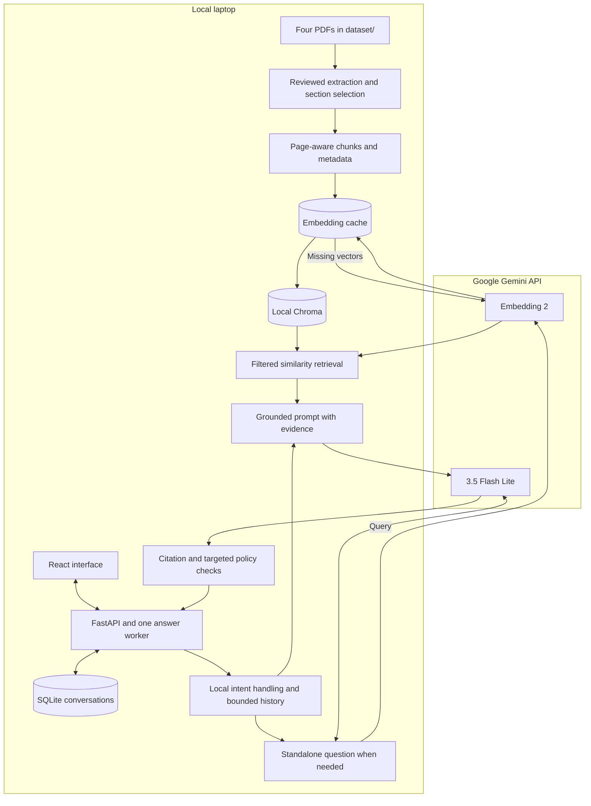

# CFD Student Compass

A local conversational guide to FAST-NUCES undergraduate policies, Chiniot-Faisalabad campus services and financial assistance.

Ask questions in a React chat interface, inspect cited PDF passages and return to saved conversations. The backend uses ordinary conversational RAG: retrieve relevant document evidence, then generate a grounded explanation. This is a student-built guide, not an official university decision service.

## What is included

- The **four exact approved PDFs** in [`dataset/`](dataset/README.md), ready for local preparation.
- React + TypeScript interface with saved-chat search, new chat, rename/delete, timestamps and expandable sources.
- FastAPI backend, LangChain/LCEL pipeline, Gemini API models, local Chroma retrieval and SQLite chat storage.
- Persistent embedding cache, source-page metadata, explicit retry/discard and idempotent submissions.
- Essential documentation and a compact maintained regression suite.

No API key, personal chat database, prebuilt vector index, dependencies or generated reports are shared. Each user supplies their own API key and builds their own index. The historical development files have been removed from the default branch.

## Requirements

- Windows, **Python 3.12 x64**, and **Node.js 22.12+** (the tested environment).
- Git and internet access for dependency installation and Google API requests.
- A Gemini Developer API key with access/quota for the configured models.

The supplied launcher and browser-test command are Windows-specific. Other operating systems have not been qualified.

| Component | Selection |
|---|---|
| UI | React, TypeScript, Vite; bundled local fonts |
| Local server | FastAPI + Uvicorn, one process on loopback |
| Chat model | `gemini-3.5-flash-lite` |
| Embeddings | `gemini-embedding-2`, 768 dimensions |
| Retrieval | Persistent local Chroma with applicability filters |
| Saved chats | SQLite |
| Pipeline | LangChain Core / LCEL, fixed conversational RAG |

No model weights run on the laptop. Both generation and embeddings use Google APIs. The current pipeline uses similarity retrieval, not MMR, CRAG, Self-RAG or an agent.

## Quick start: Windows / PowerShell

### 1. Clone and install

```powershell
git clone https://github.com/AhmadAbdullah75/Fast_Student_Compass.git
cd Fast_Student_Compass
py -3.12 -m venv .venv
.\.venv\Scripts\python.exe -m pip install --upgrade pip
.\.venv\Scripts\python.exe -m pip install -r requirements-lock.txt
cd frontend
npm.cmd ci
npm.cmd run build
cd ..
```

Use `python -m venv .venv` if your selected `python` is already Python 3.12. Do not copy another computer's virtual environment. Node is needed to build the UI, not to serve an existing build.

### 2. Configure your key

```powershell
Copy-Item .env.example .env
notepad .env
```

Only copy the template if `.env` does not already exist. Enter your key locally:

```dotenv
GOOGLE_API_KEY=your_key_here
CHAT_MODEL=gemini-3.5-flash-lite
EMBEDDING_MODEL=gemini-embedding-2
EMBEDDING_DIMENSIONS=768
```

Get a key from [Google AI Studio](https://aistudio.google.com/). Verify project billing, eligibility and quota there. Free access is quota-limited and model availability can change. The application does not enforce a monetary cap: a key from a billed project can incur charges. There is no paid/provider fallback. Restart the backend after editing `.env`.

### 3. Prepare the included dataset and index it

**You do not need to find or download the PDFs separately.** They are included in `dataset/`. The application selects them automatically and verifies their reviewed hashes against `sources.json`.

```powershell
.\.venv\Scripts\python.exe -m compass.cli audit
.\.venv\Scripts\python.exe -m compass.cli prepare
.\.venv\Scripts\python.exe -m compass.cli preflight
.\.venv\Scripts\python.exe -m compass.cli ingest
```

- `audit`: local extraction report and document fingerprints under ignored `reports/`.
- `prepare`: reviewed section selection and page-aware chunks; no model calls.
- `preflight`: actual chat plus document/query embedding access checks; consumes quota.
- `ingest`: embeds missing chunks and writes the local Chroma index; consumes embedding quota.

The approved dataset produces **108 chunks**. Some PDF pages use reviewed extraction/table/OCR overrides already stored in `sources.json`. Do not blindly replace a source hash if a PDF changes. Inspect the changed document and section mapping first.

On quota failure, stop requests and check the Google project limits. Wait for reset or available eligible quota, then resume explicitly. Same-project API keys may share limits. Successful embeddings are cached, so explicit ingestion resumption can reuse completed work.

### 4. Start the application

```powershell
powershell.exe -NoProfile -ExecutionPolicy Bypass -File ./run.ps1 -SkipBuild
```

Open **http://localhost:8501**. Press **Ctrl+C** in the server terminal to stop.

For later launches, use the same command; do not rebuild the index on every startup. If UI source changes, run `run.ps1` without `-SkipBuild` to build it again.

The launcher also works in VS Code's Git Bash terminal. To activate Python there, use `source .venv/Scripts/activate`. Run one backend process without multiple Uvicorn workers. Keep the loopback binding; this project is not a public deployment configuration.

## Using the chatbot

1. The app opens an empty draft. Enter submits; Shift+Enter adds a newline. The question appears immediately while generation runs.
2. Read the answer and expand **Sources** to inspect the supporting passage and PDF page. A resolving citation is not, by itself, proof of every attached claim.
3. Ask follow-ups or correct the person, numbers and scenario explicitly. Ambiguous references may require clarification.
4. Use **New conversation** for an isolated history, or reopen saved chats in the sidebar. The conversation menu offers rename/delete.
5. **Response details** exposes optional retrieval/context/timing diagnostics. If a request fails, its saved question can be retried or discarded.

New drafts are saved only after the first message. Full transcripts persist in SQLite, while policy reasoning uses at most the latest six completed exchanges within an estimated 2,500-token budget. Recognized saved-question recall reads the transcript locally; extractive recaps are not new policy verification.

## Architecture



See [architecture](docs/ARCHITECTURE.md) for the request lifecycle and API routes, [limitations](docs/LIMITATIONS.md) for coverage/privacy boundaries, and [testing](docs/TESTING.md) for checks you can reproduce.

## Repository layout

```text
Fast_Student_Compass/
├── README.md
├── .env.example
├── .gitignore
├── requirements.txt          # Runtime version ranges
├── requirements-lock.txt     # Pinned runtime dependencies
├── requirements-dev.txt      # Optional regression-test dependencies
├── run.ps1
├── sources.json              # Reviewed source metadata and text overrides
├── compass/                  # Required Python application code
├── frontend/                 # React source, build configuration and browser tests
├── dataset/                  # Four approved PDFs and provenance/setup notes
├── docs/                     # Architecture, limitations and testing
└── tests/                    # Compact maintained regression suite
```

`data/` is generated locally for Chroma, the embedding cache, manifest and saved chats. `reports/` holds generated preparation/test output. Both are ignored by Git, as are `.env`, `.venv`, `node_modules` and frontend builds. Stop the app before making a consistent backup of `data/`; do not delete it just to clear one chat.

For existing installations, `data/originals/` remains a fallback if a configured PDF is not present in `dataset/`. Shipped dataset files take precedence. Their content, model, splitting and reviewed source selections have not changed.

## Development and tests

Optional Python regressions (offline; no API key or index needed):

```powershell
.\.venv\Scripts\python.exe -m pip install -r requirements-dev.txt
.\.venv\Scripts\python.exe -m pytest -q
```

Browser workflows use an isolated fixture backend, not Google:

```powershell
cd frontend
npx.cmd playwright install chromium
npm.cmd run test:e2e
cd ..
```

For UI development, run the backend at 8501, then `npm.cmd run dev` in `frontend`. Vite runs on 5173 and proxies `/api` to the backend. Normal use needs only the built UI and Python server at 8501.

## Important limits and troubleshooting

- The app answers only from approved sections of four static documents. It cannot verify new announcements, official records or real-time availability.
- Source conflicts, extraction artifacts, retrieval misses, bounded context and model errors remain possible. The latest cleanup verification is described in `docs/TESTING.md`; it is not a guarantee of future answer accuracy.
- Independent review of high-impact university-policy interpretations remains pending. Confirm important decisions with the university.
- Questions, relevant history and evidence are sent to Google. Local chats are not encrypted or separated by user accounts. Do not enter sensitive personal records.
- Missing key: edit backend `.env` and restart. Missing build: run `npm.cmd ci` and `npm.cmd run build` in `frontend`.
- Missing index: run preparation and ingestion. Hash mismatch: review the source rather than bypassing verification.
- Port occupied: stop the old server before launching another. Quota failure: stop repeated retries and check project limits.

Publishing this repository makes source and reference PDFs available for local reproduction; it does not deploy the website or make it an official university service. Reference documents remain the work of their respective owners; no new open-content license is asserted for them.
